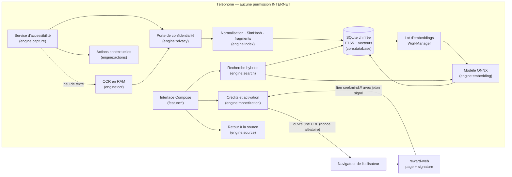
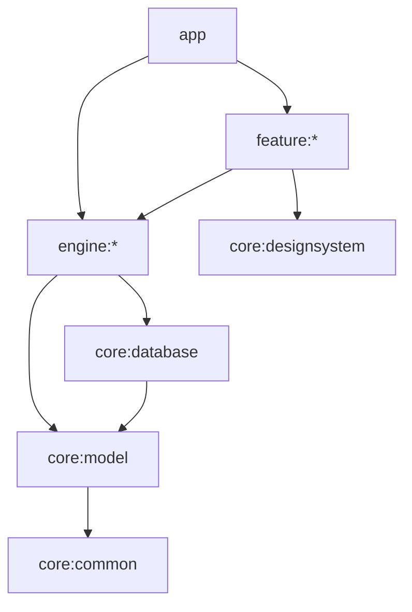
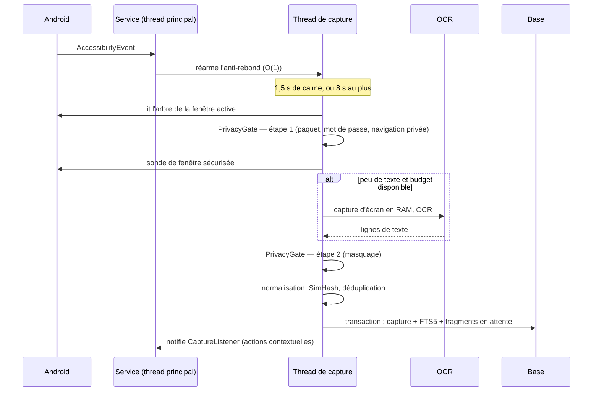
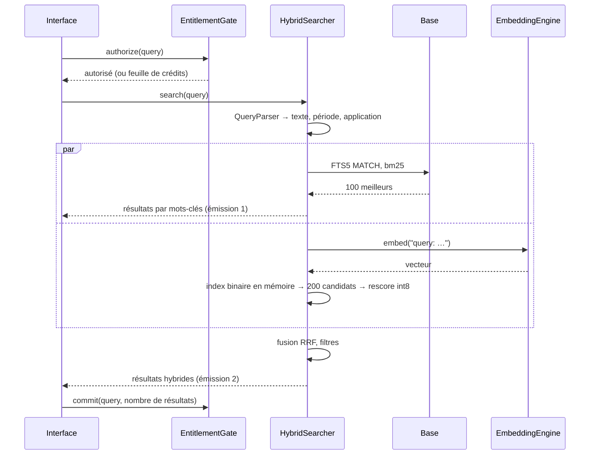

# 03 — Architecture

| | |
|---|---|
| **Version** | 1.0 — 12 novembre 2026 |
| **Documents liés** | [Cahier des charges](02-cahier-des-charges.md) · [Specs](specs/) · [ADR](adr/README.md) |

## 1. Vue d'ensemble

SeekMind est une application Android mono-processus, sans serveur. Un service d'accessibilité alimente
un pipeline événementiel qui écrit dans une base SQLite chiffrée ; l'interface interroge cette base.
Le seul composant hors de l'appareil est une page web de publicité, ouverte dans le navigateur.



## 2. Principes directeurs

1. **Les invariants sont structurels.** Zéro réseau, passivité et absence d'image persistée ne reposent
   pas sur la discipline des développeurs : ils sont vérifiés à chaque build (§10).
2. **Le texte d'abord, l'image en dernier recours.** L'arbre d'accessibilité coûte peu ; l'OCR n'est
   déclenché que s'il apporte quelque chose, et sous budget.
3. **Rapide maintenant, intelligent plus tard.** L'insertion plein texte est synchrone ; le calcul des
   vecteurs est différé, par lots, hors des moments où il gênerait.
4. **Une seule base, un seul processus.** Pas d'IPC, pas de synchronisation, pas de cache annexe du contenu.
5. **Logique pure séparée d'Android.** Les algorithmes (anti-rebond, SimHash, tokenizer, analyse de
   requête, fusion, jetons) sont du Kotlin pur, testé sur JVM. Les classes Android sont de fines enveloppes.
6. **Tout est réglable en un seul endroit.** Chaque sous-système lit ses constantes dans un objet `*Config`.

## 3. Modules

### 3.1 Liste

| Module | Rôle | Types publics principaux |
|---|---|---|
| `:app` | Application, manifeste, graphe Hilt, navigation, activité de liens | `SeekMindApp`, `MainActivity`, `LinkActivity` |
| `:core:common` | Utilitaires sans dépendance Android lourde | `Clock`, `DispatcherProvider`, `SmLog`, `Outcome` |
| `:core:model` | Modèles de domaine et interfaces entre modules | `Capture`, `ScreenSnapshot`, `SourceRef`, `SearchQuery`, `SearchHit`, `Entitlement`, ports |
| `:core:database` | Base chiffrée, schéma, DAO, clé, purge, réglages | `SeekMindDatabase`, `CaptureStore`, `SearchStore`, `SettingsRepository` |
| `:core:designsystem` | Thème et composants Compose | `SeekMindTheme`, composants |
| `:core:testing` | Doubles de test, jeux de données | `FakeClock`, `TestDispatchers`, fabriques |
| `:engine:privacy` | Décision de capture, listes d'applications, masquage | `PrivacyGate`, `SensitiveApps`, `Redactor` |
| `:engine:capture` | Service d'accessibilité, anti-rebond, lecture de l'arbre, orchestration | `SeekMindAccessibilityService`, `Debouncer`, `TreeExtractor`, `CapturePipeline` |
| `:engine:ocr` | Capture d'écran en RAM, sonde de fenêtre sécurisée, reconnaissance | `ScreenshotSource`, `SecureWindowProbe`, `OcrEngine`, `OcrPolicy`, `ThermalGovernor` |
| `:engine:index` | Normalisation, déduplication, fragments, file et lot d'embeddings | `TextNormalizer`, `SimHash`, `Chunker`, `IngestService`, `EmbeddingWorker` |
| `:engine:embedding` | Tokenizer, runtime ONNX, quantification | `Tokenizer`, `EmbeddingEngine`, `VectorCodec` |
| `:engine:search` | Analyse de requête, recherche lexicale et vectorielle, fusion | `QueryParser`, `LexicalSearcher`, `VectorIndex`, `HybridSearcher` |
| `:engine:source` | Résolution du retour à la source | `SourceResolver`, `SourceLauncher` |
| `:engine:actions` | Détection d'entités, actions, pastille | `EntityDetector`, `ActionResolver`, `PillOverlay` |
| `:engine:monetization` | Crédits, jetons, activation | `EntitlementGate`, `CreditLedger`, `TokenVerifier`, `RewardFlow` |
| `:feature:onboarding` | Présentation, divulgation, activation | écrans et ViewModels |
| `:feature:search` | Recherche, résultats, détail | idem |
| `:feature:journal` | Journal | idem |
| `:feature:settings` | Réglages, diagnostic | idem |
| `:feature:paywall` | Feuille de crédits, activation | idem |
| `:fixtureapp` | Application de test (non publiée) | activités de [06 §3](06-qualite-tests-ci.md#3-application-de-test) |

Hors Gradle : `build-logic/` (plugins de convention), `tools/model/` et `tools/license/` (Python),
`reward-web/` (TypeScript, Cloudflare Workers), `testdata/` (jeux de référence versionnés).

### 3.2 Graphe de dépendances autorisé



Dépendances entre modules `engine` (les seules admises) :

| Module | Peut dépendre de |
|---|---|
| `engine:capture` | `engine:privacy`, `engine:ocr`, `engine:index` |
| `engine:index` | `engine:embedding` |
| `engine:search` | `engine:embedding` |
| `engine:actions` | — (s'abonne aux captures par l'interface `CaptureListener` de `core:model`) |
| `engine:privacy`, `engine:ocr`, `engine:embedding`, `engine:source`, `engine:monetization` | — |

Règles : aucun module `engine` ne dépend d'un module `feature` ; aucun module `feature` ne dépend d'un
autre module `feature` (la navigation passe par `:app`) ; seul `core:database` connaît Room et SQLCipher.
Un plugin de convention fait échouer le build si une dépendance sort de ce graphe (ticket M0-04).

### 3.3 Interfaces entre modules

Déclarées dans `core:model` (paquet `app.seekmind.core.model.port`), implémentées par les modules `engine`,
reliées par Hilt dans `:app`. Signatures complètes dans les specs.

| Interface | Implémentée par | Utilisée par | Spec |
|---|---|---|---|
| `PrivacyGate` | `engine:privacy` | `engine:capture` | [confidentialite](specs/confidentialite.md) |
| `OcrEngine`, `ScreenshotSource` | `engine:ocr` | `engine:capture` | [ocr](specs/ocr.md) |
| `CaptureSink` | `engine:index` | `engine:capture` | [indexation](specs/indexation.md) |
| `CaptureListener` | `engine:actions` | `engine:capture` | [actions-intelligentes](specs/actions-intelligentes.md) |
| `EmbeddingEngine` | `engine:embedding` | `engine:index`, `engine:search` | [embeddings](specs/embeddings.md) |
| `SearchEngine` | `engine:search` | `feature:search` | [recherche](specs/recherche.md) |
| `SourceResolver` | `engine:source` | `feature:search`, `feature:journal` | [retour-source](specs/retour-source.md) |
| `EntitlementGate` | `engine:monetization` | `feature:search`, `feature:paywall` | [monetisation](specs/monetisation.md) |

## 4. Flux principaux

### 4.1 Capture



### 4.2 Embeddings différés

`EmbeddingWorker` (WorkManager, périodique 15 min, batterie non faible ; déclenchement supplémentaire en
charge) lit les fragments en attente par lots de 32, calcule les vecteurs, les quantifie (int8 et binaire)
et les écrit. Il s'arrête si l'état thermique monte, si l'économie d'énergie s'active, ou après 9 min.

### 4.3 Recherche



### 4.4 Récompense publicitaire

Détaillé dans [specs/monetisation §4](specs/monetisation.md). L'application crée un nonce aléatoire,
ouvre `https://<domaine>/reward?n=<nonce>` dans un onglet personnalisé, et reçoit en retour un lien
`seekmind://reward?t=<jeton>`. Elle vérifie la signature ES256 avec une clé publique embarquée et le
rattachement du nonce à une demande en attente, puis crédite le solde.

## 5. Processus et threads

Un seul processus. Pas de service de premier plan, pas de notification permanente.

| Exécution | Travail | Règle |
|---|---|---|
| Thread principal | Rappels du service d'accessibilité, interface | ≤ 2 ms par événement : aucun accès à l'arbre, à la base ni au disque |
| `sm-capture` (un `HandlerThread`, dispatcher mono-thread) | Anti-rebond, lecture de l'arbre, porte, normalisation, insertion | Sérialise toute l'ingestion : pas de verrou, ordre garanti |
| Exécuteur ML Kit | OCR | Résultat renvoyé sur `sm-capture` |
| `Dispatchers.Default` limité à 1 | Lots d'embeddings | Session ONNX avec 2 threads internes (4 en charge) |
| `Dispatchers.IO` | Lectures de la base pour l'interface, purge | Room en mode WAL : lecteurs concurrents, un écrivain |
| Portée du ViewModel | Recherche | Annulation à chaque nouvelle requête |

Contre-pression : si une capture est en cours de traitement lorsque l'anti-rebond se déclenche, le
déclenchement est fusionné (une seule exécution en attente, jamais de file).

## 6. Données

Schéma, PRAGMA, déclencheurs et migrations : [specs/stockage](specs/stockage.md). Synthèse :

| Table | Contenu |
|---|---|
| `capture` | Un écran indexé : texte, métadonnées, source, SimHash, dates |
| `capture_fts` | Index FTS5 à contenu externe sur `capture` |
| `chunk` | Fragments d'une capture et état de leur embedding (file d'attente) |
| `embedding` | Vecteur int8 (384 octets) et code binaire (48 octets) par fragment |
| `app_rule` | Inclusion ou exclusion par application |
| `secure_probe` | Cache des sondes de fenêtre sécurisée (Android 11–13) |
| `credit_ledger`, `reward_request`, `license` | Monétisation |
| `search_history` | Historique des requêtes |
| `metric_daily` | Compteurs de diagnostic, sans contenu |
| `meta` | Versions, génération de l'index vectoriel |

Réglages non sensibles (bascules, rétention, consentement) : DataStore Preferences.

## 7. Configuration

Chaque sous-système expose un objet `*Config` immuable, injecté, dont les valeurs par défaut sont celles
des specs : `CaptureConfig`, `PrivacyConfig`, `OcrConfig`, `IndexConfig`, `EmbeddingConfig`, `SearchConfig`,
`ActionsConfig`, `MonetizationConfig`, `StorageConfig`. Aucune constante de réglage en dur ailleurs.
Les tests injectent des configurations réduites (délais courts, budgets petits).

## 8. Pile technique et versions

Versions stables relevées sur Google Maven et Maven Central le 12 novembre 2026. Le ticket M0-01 les fige
dans `gradle/libs.versions.toml` ; toute montée de version ultérieure fait l'objet d'une PR dédiée.
Si deux versions de ce tableau se révèlent incompatibles entre elles (par exemple KSP et Kotlin), M0-01
retient la combinaison stable la plus récente qui compile et corrige le tableau.

| Domaine | Composant | Version |
|---|---|---|
| Build | JDK | 17 minimum (21 recommandé) |
| | Gradle | 9.9.1 |
| | Android Gradle Plugin | 9.5.1 (Kotlin intégré : ne pas appliquer `kotlin-android`) |
| | Kotlin | 2.4.21 |
| | KSP | 2.3.13 |
| SDK | `compileSdk` | 37 (plateforme `android-37.0`) |
| | `targetSdk` | 36 (exigence Google Play depuis le 31 août 2026) |
| | `minSdk` | 30 |
| | Build-tools | 37.0.0 |
| Interface | Compose BOM | 2026.09.00 (Material 3) |
| | Activity Compose | 1.13.0 |
| | Navigation Compose | 2.10.2 |
| | Lifecycle | 2.11.0 |
| | Core KTX | 1.19.1 |
| Données | Room | 2.8.5 |
| | SQLCipher for Android (`net.zetetic:sqlcipher-android`) | 4.20.0 |
| | `androidx.sqlite` | 2.7.1 |
| | DataStore Preferences | 1.3.0 |
| Arrière-plan | WorkManager | 2.12.0 |
| Injection | Hilt | 2.60.1 (`androidx.hilt` 1.4.0) |
| Asynchrone | kotlinx-coroutines | 1.11.0 |
| Sérialisation | kotlinx-serialization-json | 1.13.0 |
| OCR | ML Kit Text Recognition v2, modèle embarqué (`com.google.mlkit:text-recognition`) | 16.0.1 |
| Embeddings | ONNX Runtime Android (`com.microsoft.onnxruntime:onnxruntime-android`) | 1.31.1 |
| | Modèle `intfloat/multilingual-e5-small` | révision `614241f622f53c4eeff9890bdc4f31cfecc418b3` |
| Web | `androidx.browser` (onglets personnalisés) | 1.10.0 |
| Sécurité | `androidx.biometric` | 1.1.0 |
| Tests | JUnit 4.13.2 · Truth 1.4.5 · Turbine 1.2.1 · MockK 1.14.12 · Robolectric 4.17 | |
| | AndroidX Test runner 1.7.0 · ext-junit 1.3.0 · UI Automator 2.4.1 · Benchmark 1.5.0 | |
| Qualité | Spotless + ktlint, Android Lint | dernières stables à M0-02 |
| Outils | Python 3.11+ (`tools/`), Node 22 (`reward-web/`) | |

Bibliothèques **exclues** par décision : tout client HTTP, Firebase, Google Mobile Ads, Play Billing (v2),
`sqlite-vec` ([ADR-0005](adr/0005-recherche-vectorielle-en-memoire.md)), variantes ML Kit « non embarquées »
qui téléchargent leur modèle.

## 9. Build

- **Types de build :** `debug` (suffixe `.debug`, clés de test acceptées, crochets de test) ; `release`
  (R8, réduction des ressources) ; `benchmark` (dérivé de `release`, pour Macrobenchmark).
- **Pas de variantes de produit** en v1.
- **ABI :** `arm64-v8a` et `armeabi-v7a` en production ; `x86_64` en plus pour `debug` (émulateur).
- **Bibliothèques natives** (SQLCipher, ML Kit, ONNX Runtime) : alignement 16 Ko vérifié en CI.
- **Modèle d'embeddings :** asset non compressé du module `engine:embedding`, produit par `tools/model`
  et jamais committé. Si le module de base dépassait la limite de taille de Google Play, bascule vers un
  pack d'assets installé avec l'application (aucun téléchargement par l'application).
- **Signature :** clé d'import locale hors dépôt, Play App Signing ([04 §3](04-prerequis.md#3-clés-et-secrets)).
- **R8 :** règles de conservation pour ONNX Runtime (JNI), SQLCipher, ML Kit, Room, Hilt ; un test
  instrumenté s'exécute sur le build `release` pour détecter les suppressions abusives.

## 10. Manifeste cible et garde-fous

### 10.1 Manifeste

```xml
<manifest xmlns:android="http://schemas.android.com/apk/res/android"
    xmlns:tools="http://schemas.android.com/tools">

    <!-- INV-01. ML Kit (via com.google.android.datatransport) déclare INTERNET : on la retire. -->
    <uses-permission android:name="android.permission.INTERNET" tools:node="remove" />

    <uses-permission android:name="android.permission.USE_BIOMETRIC" />

    <!-- Visibilité des paquets sans QUERY_ALL_PACKAGES : applications lançables et navigateurs. -->
    <queries>
        <intent>
            <action android:name="android.intent.action.MAIN" />
            <category android:name="android.intent.category.LAUNCHER" />
        </intent>
        <intent>
            <action android:name="android.support.customtabs.action.CustomTabsService" />
        </intent>
        <intent>
            <action android:name="android.intent.action.VIEW" />
            <category android:name="android.intent.category.BROWSABLE" />
            <data android:scheme="https" />
        </intent>
    </queries>

    <application
        android:name=".SeekMindApp"
        android:allowBackup="false"
        android:fullBackupContent="false"
        android:dataExtractionRules="@xml/data_extraction_rules"
        android:usesCleartextTraffic="false">

        <activity android:name=".MainActivity" android:exported="true">
            <intent-filter>
                <action android:name="android.intent.action.MAIN" />
                <category android:name="android.intent.category.LAUNCHER" />
            </intent-filter>
        </activity>

        <!-- Réception des jetons de récompense et d'activation. -->
        <activity android:name=".link.LinkActivity" android:exported="true"
            android:launchMode="singleTask" android:noHistory="true">
            <intent-filter>
                <action android:name="android.intent.action.VIEW" />
                <category android:name="android.intent.category.DEFAULT" />
                <category android:name="android.intent.category.BROWSABLE" />
                <data android:scheme="seekmind" android:host="reward" />
                <data android:scheme="seekmind" android:host="activate" />
            </intent-filter>
        </activity>

        <service
            android:name="app.seekmind.engine.capture.SeekMindAccessibilityService"
            android:exported="true"
            android:label="@string/a11y_service_label"
            android:permission="android.permission.BIND_ACCESSIBILITY_SERVICE">
            <intent-filter>
                <action android:name="android.accessibilityservice.AccessibilityService" />
            </intent-filter>
            <meta-data
                android:name="android.accessibilityservice"
                android:resource="@xml/accessibility_service_config" />
        </service>

        <service
            android:name="app.seekmind.engine.capture.PauseTileService"
            android:exported="true"
            android:icon="@drawable/ic_tile"
            android:label="@string/tile_label"
            android:permission="android.permission.BIND_QUICK_SETTINGS_TILE">
            <intent-filter>
                <action android:name="android.service.quicksettings.action.QS_TILE" />
            </intent-filter>
        </service>
    </application>
</manifest>
```

### 10.2 Permissions admises dans le manifeste fusionné `release`

| Permission | Origine | Statut |
|---|---|---|
| `USE_BIOMETRIC`, `USE_FINGERPRINT` | `androidx.biometric` | Admise |
| `WAKE_LOCK`, `RECEIVE_BOOT_COMPLETED`, `FOREGROUND_SERVICE` | WorkManager | Admises |
| `ACCESS_NETWORK_STATE` | WorkManager, datatransport | Tolérée : elle permet de connaître l'état du réseau, pas d'émettre. Objectif : la retirer si le prototype M0-07 montre que rien n'en dépend. |
| `<applicationId>.DYNAMIC_RECEIVER_NOT_EXPORTED_PERMISSION` | `androidx.core` | Admise |
| `QUERY_ADVANCED_PROTECTION_MODE` | Ticket M10-08, optionnel | Admise si le ticket est réalisé |
| **Toute autre**, en particulier `INTERNET` | — | **Build en échec** |

### 10.3 Garde-fous automatiques

| Garde-fou | Vérifie | Créé par |
|---|---|---|
| `:app:verifyReleaseManifest` | Permissions (§10.2), composants exportés (INV-12), `allowBackup`, capacités du service d'accessibilité (uniquement `canRetrieveWindowContent` et `canTakeScreenshot`) | M0-04 |
| `scripts/check-forbidden-apis.sh` | Motifs interdits dans les sources hors tests : API réseau, `WebView`, `ConnectivityManager`, `MediaProjection`, `performGlobalAction`, `performAction(`, `dispatchGesture`, `GestureDescription`, `Bitmap.compress`, `MediaStore`, `android.util.Log` hors `core:common` | M0-04 |
| `:app:verifyDependencies` | Dépendances d'exécution `release` ⊆ `gradle/dependency-allowlist.txt` | M0-04 |
| Plugin de convention | Graphe de modules du §3.2 | M0-04 |
| `scripts/check-elf-alignment.sh` | Alignement 16 Ko des `.so` de l'APK `release` | M0-04 |
| Lint | Chaînes non traduites, texte en dur dans l'interface | M0-02 |

## 11. Erreurs et journalisation

- Les erreurs attendues (arbre indisponible, capture d'écran refusée, jeton invalide) sont des valeurs
  (`Outcome`), pas des exceptions. Le pipeline de capture ne propage jamais d'exception au service :
  une capture ratée est comptée et abandonnée.
- `SmLog` : en `release`, niveaux WARN et ERROR seulement, sans contenu utilisateur (INV-07).
- Le diagnostic local (`metric_daily`) compte par jour : captures stockées, rejets par motif, OCR
  effectués ou sautés, fragments vectorisés, durées médianes. Il est consultable dans Réglages → Diagnostic
  et exportable en texte par un partage explicite de l'utilisateur.

## 12. Nommage

- Paquet racine : `app.seekmind`. Un module `:engine:capture` a pour paquet `app.seekmind.engine.capture`.
- Identifiant d'application : `app.seekmind` (`app.seekmind.debug` en debug, `app.seekmind.fixture` pour
  l'application de test) — à aligner sur la décision D-03.
- Ressources préfixées par module (`search_…`, `onb_…`) pour éviter les collisions.
