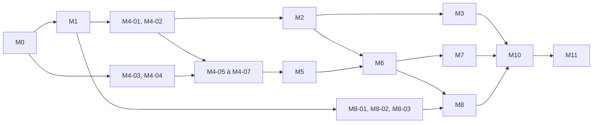

# Plan de développement

| | |
|---|---|
| **Version** | 1.1 — 12 novembre 2026 (décisions du porteur intégrées) |
| **Objet** | Découper la v1 en tickets exécutables un par un par des agents de développement |

## 1. Mode d'emploi

### 1.1 Confier un ticket à un agent

```text
Implémente le ticket <ID> décrit dans docs/plan/<fichier du jalon>.
Lis d'abord AGENTS.md, puis les sections de spécification référencées par le ticket.
Respecte la « Definition of Done » et ouvre une pull request vers main.
```

Règles : un ticket = une branche = une PR ; l'agent vérifie que les dépendances du ticket sont `Fait`,
ne déborde pas du périmètre, et passe le statut du ticket à `Fait` dans la même PR.

### 1.2 Lire un ticket

| Champ | Sens |
|---|---|
| **Statut** | `À faire`, `En cours`, `Fait`, `Bloqué` (avec la raison), `Reporté` |
| **Dépend de** | Tickets qui doivent être `Fait` avant de commencer |
| **Référence** | Sections de spécification à lire — elles font foi en cas de doute |
| **À faire** | Étapes, dans l'ordre |
| **Critères d'acceptation** | Ce que les tests doivent démontrer |
| **Validation manuelle** | Vérification sur un vrai téléphone, par un humain, consignée dans la PR |

Les tickets ne répètent pas les spécifications : ils disent quoi construire et comment savoir que c'est fini.

### 1.3 Quand la réalité contredit la spec

Les prototypes du jalon M0 existent pour cela. Si une mesure ou un comportement contredit une
spécification, l'agent corrige la spec (et l'ADR concerné) dans la PR et le signale dans « Écarts ».

### 1.4 Revue et fusion

Décision D-14 : une PR est fusionnée dans `main` quand **trois** conditions sont réunies.

1. Les vérifications `ci` et `device-tests` sont vertes.
2. Un **second agent**, dans une session distincte de celle qui a écrit le code, a relu la PR et n'a
   laissé aucun constat bloquant. Consigne type :

   ```text
   Relis la pull request <numéro> du dépôt Seekmind par rapport au ticket <ID> et à AGENTS.md.
   Vérifie les critères d'acceptation, les invariants et l'absence de débordement de périmètre.
   Poste tes constats sur la PR ; n'écris pas de code.
   ```

3. Si le ticket figure dans la liste ci-dessous, le **porteur du projet** a donné son accord sur la PR.

Tickets soumis à l'accord du porteur du projet :

| Motif | Tickets |
|---|---|
| Confidentialité et consentement | M2-05, M2-06, M3-02, M6-02 |
| Publicité, crédits, activation, variante de repli | Tous les tickets de M8 |
| Publication | Tous les tickets de M11 |
| Validation sur téléphone | Tout ticket portant la mention « Validation manuelle » |
| Règles du projet | Toute PR qui modifie `AGENTS.md`, un ADR, un garde-fou ou une liste blanche |

L'auteur d'une PR ne la relit pas lui-même et ne la fusionne pas : la fusion est automatique (réglage du
dépôt) une fois les conditions réunies.

## 2. Jalons

| Jalon | Objectif | Résultat observable | Tickets |
|---|---|---|---|
| [M0](M0-fondations.md) | Fondations et levée des risques techniques | Le projet compile en deux variantes, la CI tourne, quatre prototypes ont rendu leur verdict | 10 |
| [M1](M1-donnees.md) | Socle de données | Base chiffrée, plein texte, dépôts, purge | 7 |
| [M2](M2-capture.md) | Capture et confidentialité | Le texte des écrans arrive en base, les écrans sensibles et les familles désactivées sont rejetés | 8 |
| [M3](M3-ocr.md) | OCR et fenêtres sécurisées | Le texte des images est indexé, sans image sur le disque | 5 |
| [M4](M4-indexation.md) | Indexation, embeddings, packs de langue | Déduplication, fragments, vecteurs calculés en arrière-plan, modèle remplaçable | 7 |
| [M5](M5-recherche.md) | Recherche hybride | Requêtes en langage naturel, qualité mesurée | 8 |
| [M6](M6-interface.md) | Interface | Application utilisable de bout en bout | 9 |
| [M7](M7-retour-source.md) | Retour à la source | Un résultat rouvre sa page ou son application | 3 |
| [M8](M8-monetisation.md) | Monétisation | Crédits, publicité récompensée AdMob, code d'activation, variante `offline` | 7 (+1 hors plan) |
| [M10](M10-durcissement.md) | Durcissement | Cibles de performance tenues, revue de sécurité | 8 |
| [M11](M11-publication.md) | Publication | Dossier Google Play complet, version en test fermé | 6 |
| [M9](M9-actions.md) | Actions contextuelles — **reporté en v1.1** | Pastille et actions depuis le détail | 5, après la première publication |

## 3. Ordre et parallélisme



Le schéma ne montre que les dépendances directes. `M6-01` (système de design) ne dépend que de `M0-01`
et peut commencer dès le début ; il n'est pas représenté. Après M1, quatre pistes peuvent avancer en
parallèle, chacune par un agent :

| Piste | Tickets | Remarque |
|---|---|---|
| **A — Capture** | M4-01, M4-02, puis M2, puis M3 | `M2-06` a besoin de `M4-02` |
| **B — Sens** | M4-03, M4-04, puis M4-05 à M4-07, puis M5 | Dépend des artefacts de `M0-10` |
| **C — Interface** | M6-01, puis M6-02 dès `M2-01` fait, puis le reste de M6 à mesure que M5 avance | |
| **D — Monétisation** | M8-01, M8-02, M8-03 | Registre, jetons et module publicitaire ne dépendent que de M1 |

Les jalons M10 et M11 sont séquentiels et viennent en dernier ; `M11-01` à `M11-04` (contenus) peuvent
commencer dès que l'interface est stable.

## 4. Points d'arrêt pour le porteur du projet

| Moment | Ce qui est attendu de vous |
|---|---|
| Avant M0 | Activer GitHub Actions et la fusion automatique ; mettre en place l'environnement des agents ([prérequis §8](../04-prerequis.md#8-listes-de-contrôle)) |
| Fin de M0 | Lire les quatre rapports de prototype (`docs/prototypes/`) : poursuivre, ou réviser une décision d'architecture |
| Avant M8 | Compte AdMob, identifiants du bloc récompensé, message de consentement, clé de licence |
| Fin de M6 | Première prise en main sur votre téléphone |
| Fin de M8 | Essai d'une annonce de test et d'un code d'activation |
| Fin de M10 | Recette ([cahier des charges §7](../02-cahier-des-charges.md#7-recette-de-la-v1)) |
| M11 | Test fermé, puis soumission à Google Play |

## 5. Liste des tickets

Les statuts sont tenus dans les fichiers de jalon (un seul endroit, pour limiter les conflits de fusion).

| ID | Titre | Dépend de |
|---|---|---|
| M0-01 | Squelette Gradle multi-modules et variantes | — |
| M0-02 | Analyse statique et formatage | M0-01 |
| M0-03 | Intégration continue `ci` | M0-02 |
| M0-04 | Garde-fous automatiques | M0-01 |
| M0-05 | Environnement des agents | M0-01 |
| M0-06 | Prototype S1 : SQLCipher, Room, FTS5 | M0-01, M0-08 |
| M0-07 | Prototype S2 : ML Kit sans télémétrie | M0-04, M0-08 |
| M0-08 | Prototype S3 : service d'accessibilité, application de test, CI `device-tests` | M0-03 |
| M0-09 | Prototype S4 : embeddings sur appareil | M0-08, M0-10 |
| M0-10 | Outillage des modèles | M0-01 |
| M1-01 | Modules `core:common` et `core:model` | M0 |
| M1-02 | Clé de la base | M1-01 |
| M1-03 | Base chiffrée et schéma v1 | M1-02 |
| M1-04 | Dépôts de captures, de recherche et de vecteurs | M1-03 |
| M1-05 | Dépôts annexes et réglages | M1-03 |
| M1-06 | Maintenance et effacement | M1-04, M1-05 |
| M1-07 | Outils de test et premiers bancs de mesure | M1-04 |
| M2-01 | Service, routage des événements, état | M1-05 |
| M2-02 | Anti-rebond | M1-01 |
| M2-03 | Lecture de l'arbre | M1-01 |
| M2-04 | Métadonnées d'écran et URL | M2-03 |
| M2-05 | Porte de confidentialité et familles d'applications | M1-05, M2-03 |
| M2-06 | Orchestration du pipeline | M2-01 à M2-05, M4-02 |
| M2-07 | Pause et tuile de réglages rapides | M2-01 |
| M2-08 | Tests de bout en bout de la capture | M2-06, M2-07 |
| M3-01 | Capture d'écran en mémoire | M2-01 |
| M3-02 | Sonde de fenêtre sécurisée | M3-01, M1-05 |
| M3-03 | Reconnaissance de texte | M3-01, M0-07 |
| M3-04 | Politique d'OCR et gouverneur | M3-03 |
| M3-05 | Intégration au pipeline et tests de bout en bout | M3-02, M3-04, M2-06 |
| M4-01 | Normalisation et SimHash | M1-01 |
| M4-02 | Découpage et ingestion | M4-01, M1-04 |
| M4-03 | Tokenizer | M0-10, M1-01 |
| M4-04 | Moteur d'embeddings et codage des vecteurs | M4-03, M0-09 |
| M4-05 | Lots d'embeddings | M4-04, M4-02, M3-04 |
| M4-06 | Empaquetage des modèles | M4-04 |
| M4-07 | Catalogue de modèles et packs de langue | M4-05, M4-06 |
| M5-01 | Analyse de requête | M1-01 |
| M5-02 | Expressions temporelles | M5-01 |
| M5-03 | Catalogue et filtre d'applications | M5-01 |
| M5-04 | Recherche par mots-clés | M5-01, M1-04 |
| M5-05 | Index vectoriel | M1-04, M4-04 |
| M5-06 | Recherche hybride | M5-02 à M5-05 |
| M5-07 | Évaluation et calibration | M5-06 |
| M5-08 | Mesures à 100 000 captures | M5-06, M1-07 |
| M6-01 | Système de design et navigation | M0-01 |
| M6-02 | Accueil, divulgation, familles, activation | M6-01, M2-01, M2-05 |
| M6-03 | Écran de recherche | M6-01, M5-06 |
| M6-04 | Détail d'une capture | M6-03 |
| M6-05 | Journal | M6-01, M1-04 |
| M6-06 | Réglages | M6-01, M2-07, M1-06, M4-07 |
| M6-07 | Verrouillage | M6-01 |
| M6-08 | Langues et accessibilité | M6-02 à M6-07 |
| M6-09 | État du service et dépannage | M6-03, M2-01 |
| M7-01 | Résolution et lancement | M1-01 |
| M7-02 | Règles par application | M7-01 |
| M7-03 | Intégration à l'interface | M7-01, M6-04 |
| M8-01 | Droits et registre de crédits | M1-05 |
| M8-02 | Vérification des jetons de licence | M1-01 |
| M8-03 | Module publicitaire | M1-01, M0-04 |
| M8-04 | Parcours de récompense et feuille de crédits | M8-01, M8-03, M6-03 |
| M8-05 | Outil de licences et activation | M8-02, M8-01 |
| M8-06 | Variante `offline` | M8-01, M6-02 |
| M8-07 | Récompense par le navigateur — hors plan, solution de repli | — |
| M8-08 | Tests de bout en bout de la monétisation | M8-04, M8-05, M8-06 |
| M10-01 | Campagne batterie et thermique | M3, M4, M8 |
| M10-02 | Mémoire et isolement des moteurs | M10-01 |
| M10-03 | Filtrage du texte récurrent | M5-07 |
| M10-04 | Démarrage, R8, profils de référence | M6, M8 |
| M10-05 | Revue de sécurité | M8 |
| M10-06 | Robustesse | M6, M8 |
| M10-07 | Modèles allégés et packs par langue (optionnel) | M5-07 |
| M10-08 | Spécificités des versions récentes d'Android | M6 |
| M11-01 | Fiche de l'application | M6-08 |
| M11-02 | Site et politique de confidentialité | — |
| M11-03 | Déclarations Play Console | M11-02 |
| M11-04 | Vidéo de divulgation | M6-08 |
| M11-05 | Chaîne de publication et test fermé | M10-04 |
| M11-06 | Recette et soumission | M10, M11-01 à M11-05 |
| M9-01 | *(v1.1)* Détection d'entités | M1-01 |
| M9-02 | *(v1.1)* Résolution des actions | M9-01 |
| M9-03 | *(v1.1)* Pastille | M9-02, M2-06 |
| M9-04 | *(v1.1)* Actions dans le détail d'une capture | M9-02, M6-04 |
| M9-05 | *(v1.1)* Tests de bout en bout des actions | M9-03 |
