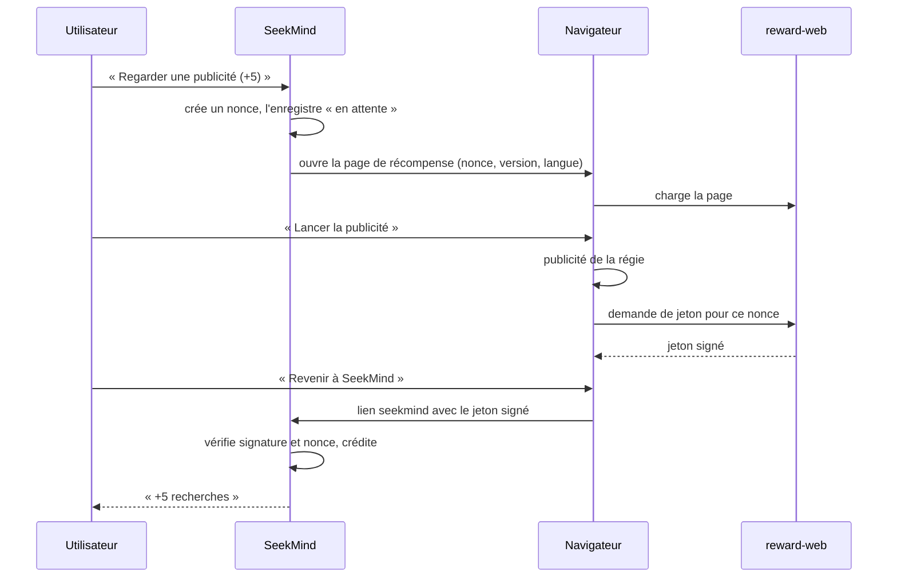

# Annexe — Récompense par le navigateur (solution de repli)

| | |
|---|---|
| **Statut** | **Non réalisée en v1.** Conservée pour la procédure de bascule de l'[ADR-0009](../adr/0009-publicite-admob-et-variante-sans-reseau.md) |
| **Origine** | [ADR-0002](../adr/0002-publicite-recompensee-hors-application.md) |
| **Quand l'utiliser** | Google Play refuse la variante `ads`, la variante `offline` est publiée à sa place, et l'on veut y rétablir une publicité récompensée sans donner d'accès réseau à l'application |

Cette annexe est une spécification complète : le jour venu, elle se découpe en tickets (§8) sans nouvelle conception.

## 1. Principe

L'application sans réseau ne peut pas afficher de publicité. Elle ouvre donc une page web de l'éditeur
dans le navigateur de l'utilisateur ; la publicité s'y affiche ; la page renvoie à l'application, par un
lien `seekmind://`, un **jeton signé** que l'application vérifie hors ligne avant de créditer cinq
recherches. Le fournisseur `BrowserRewardProvider` implémente la même interface `RewardProvider` que le
fournisseur AdMob : le reste de l'application ne change pas.



## 2. Jeton de récompense

Même format et même vérificateur que les licences ([monetisation §5](monetisation.md)) : JWS compact
ES256. Charge utile : `{"typ":"reward","n":"<nonce>","amt":5,"iat":<secondes>}`. La clé publique
d'usage `reward` (`kid` = `r1`) est ajoutée au trousseau ; `TokenVerifier` refuse tout jeton dont
l'usage ne correspond pas à son type.

## 3. Côté application

**Démarrage** (`BrowserRewardProvider.show`)

1. Refus si le plafond quotidien de récompenses est atteint.
2. Nonce : 16 octets de `SecureRandom`, en base64url (22 caractères). Ligne `reward_request` à l'état
   « en attente ». Au plus 5 demandes en attente ; les plus anciennes passent à « expirée ».
3. URL : `rewardBaseUrl?n=<nonce>&v=<versionCode>&l=<fr|en>`. **Aucun autre paramètre, jamais** : la
   construction est centralisée dans une fonction testée. C'est le seul canal par lequel une application
   sans réseau pourrait laisser fuir une information.
4. Ouverture par un onglet personnalisé (`CustomTabsIntent`), qui ne requiert aucune permission.

**Retour** — `LinkActivity` reçoit `seekmind://reward?t=<jeton>` :

1. `TokenVerifier` (usage `reward`).
2. `amt` entre 1 et `maxRewardAmount`.
3. Le nonce existe, est « en attente », et a été créé il y a moins de 2 heures.
4. Transaction : la demande passe à « utilisée » ; ligne `REWARD` dans le registre de crédits.

Tout échec affiche un message neutre et ne modifie rien. L'horloge du téléphone n'intervient que pour
l'âge de la demande locale.

**Schéma** — table ajoutée par migration :

```sql
CREATE TABLE reward_request (
  nonce       TEXT PRIMARY KEY,
  created_at  INTEGER NOT NULL,
  state       INTEGER NOT NULL,            -- 0 en attente, 1 utilisée, 2 expirée
  redeemed_at INTEGER
);
```

**Manifeste** — l'hôte `reward` est ajouté au filtre d'Intent de `LinkActivity`.

## 4. Côté web (`reward-web`)

Application Cloudflare Workers : fichiers statiques et une fonction de signature.

```text
reward-web/
  src/worker.ts            routage, POST /api/reward/grant, GET /healthz
  src/jws.ts               signature ES256 (WebCrypto)
  src/ratelimit.ts
  public/reward.html       page de récompense (FR/EN)
  public/reward.js
  public/ads/gam.js        adaptateur Google Ad Manager
  public/ads/mock.js       adaptateur de test (recette uniquement)
  wrangler.toml
  test/
```

**Page** `/reward`

1. Valide le format du nonce.
2. Explique : « Regardez une publicité pour obtenir 5 recherches. SeekMind ne transmet à cette page
   aucune information sur vous ni sur votre téléphone. »
3. Recueille le consentement exigé par la régie et la réglementation.
4. « Lancer la publicité » → `adapter.show()` rend `granted`, `closed` ou `nofill`.
5. `granted` → `POST /api/reward/grant` → bouton « Revenir à SeekMind (+5) » :
   `intent://reward?t=<jeton>#Intent;scheme=seekmind;package=<identifiant d'application>;end`, avec
   repli `seekmind://reward?t=<jeton>`. Le retour exige un tap.
6. `nofill` → même parcours pour un crédit de courtoisie d'une recherche.

**Adaptateur Google Ad Manager** (publicité récompensée pour le web, bibliothèque GPT) :

```js
googletag.cmd.push(() => {
  const slot = googletag.defineOutOfPageSlot(AD_UNIT_PATH, googletag.enums.OutOfPageFormat.REWARDED);
  if (!slot) return resolve('nofill');
  slot.addService(googletag.pubads());
  let granted = false;
  googletag.pubads().addEventListener('rewardedSlotReady', (e) => e.makeRewardedVisible());
  googletag.pubads().addEventListener('rewardedSlotGranted', () => { granted = true; });
  googletag.pubads().addEventListener('rewardedSlotClosed', () => {
    googletag.destroySlots([slot]);
    resolve(granted ? 'granted' : 'closed');
  });
  googletag.pubads().addEventListener('slotRenderEnded', (e) => {
    if (e.slot === slot && e.isEmpty) resolve('nofill');
  });
  googletag.enableServices();
  googletag.display(slot);
});
```

**Fonction** `POST /api/reward/grant`

| Entrée | Contrôle |
|---|---|
| `n` | `^[A-Za-z0-9_-]{22}$` |
| `outcome` | `granted` ou `nofill` |
| `turnstile` | Jeton anti-robot vérifié auprès de Cloudflare |
| Origine | Même origine uniquement |
| Débit | Par adresse IP : 6 par heure et 30 par jour pour `granted` ; 3 par jour pour `nofill` |

Sortie : `{"token":"<JWS>"}` avec `amt = 5` ou `amt = 1`, signé par la clé `REWARD_SIGNING_KEY`
(secret du Worker). Aucune donnée conservée hors compteurs de débit à expiration automatique.

## 5. Limite assumée

La publicité récompensée sur le web ne fournit pas de confirmation de serveur à serveur : la page
déclare elle-même que la publicité a été vue. Parades : anti-robot, limitation de débit, plafond
quotidien côté application. Le risque résiduel est un manque à gagner sur une minorité d'utilisateurs.

## 6. Prérequis propres à cette solution

- Un nom de domaine et un compte Cloudflare (ou équivalent).
- Une régie proposant la publicité récompensée pour le web ; elle exige un site réel et une approbation.
- Une paire de clés ES256 d'usage `reward` : partie privée en secret du Worker, partie publique dans le trousseau.
- Un avis juridique sur le recueil du consentement de la page.

## 7. Tests

- Vérificateur : vecteurs de jetons de récompense (valide, altéré, usage croisé, montant hors bornes).
- `BrowserRewardProvider` : nonce inconnu, déjà utilisé, trop ancien ; URL limitée à `n`, `v`, `l`.
- Bout en bout sans réseau : une activité de l'application de test joue le rôle du navigateur et
  renvoie un jeton signé par la clé de test.
- Worker : contrôles d'entrée, débit, signature vérifiée par les vecteurs communs.

## 8. Tickets à créer lors de la bascule

| Ticket | Contenu |
|---|---|
| B-01 | Clé d'usage `reward`, vecteurs de test, extension du trousseau |
| B-02 | `BrowserRewardProvider`, table `reward_request`, hôte `reward` de `LinkActivity` |
| B-03 | `reward-web` : page, adaptateurs, fonction de signature, tests, déploiement |
| B-04 | Tests de bout en bout et mise à jour de la divulgation, de la fiche et de la politique de confidentialité |
