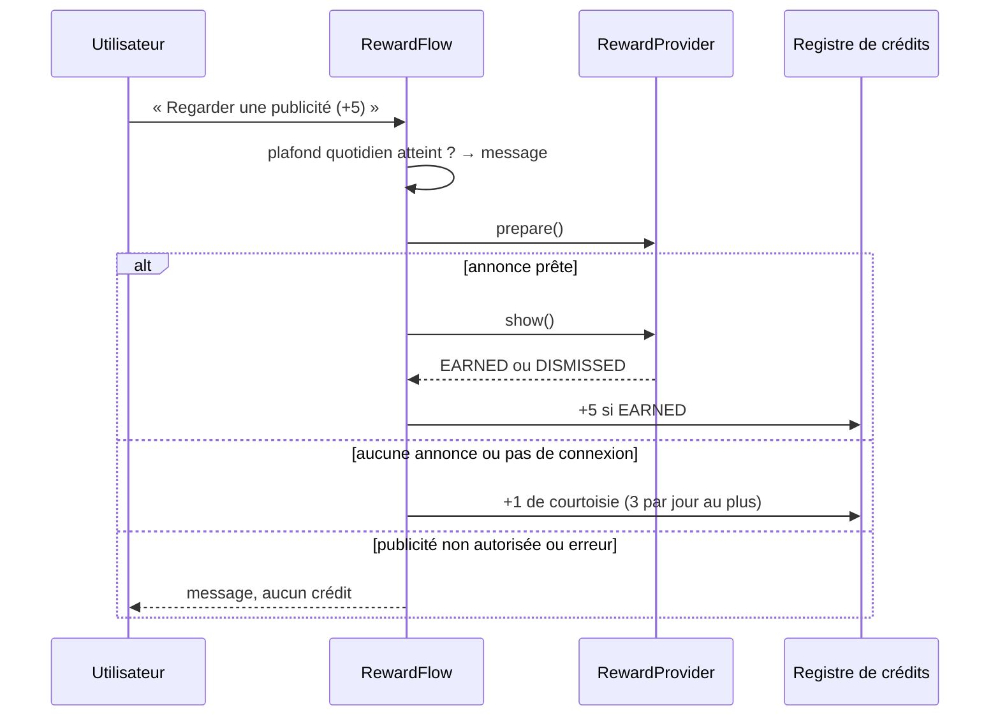

# Spec — Monétisation (`engine:monetization`, `engine:ads`, `feature:paywall`, `tools/license`)

| | |
|---|---|
| **Exigences** | EF-MON-01 à 10, INV-01, INV-08 |
| **Tickets** | M8-01 à M8-08 |
| **Voir aussi** | [ADR-0009](../adr/0009-publicite-admob-et-variante-sans-reseau.md) · [ADR-0007](../adr/0007-codes-d-activation-signes.md) · [annexe — récompense par le navigateur](annexe-recompense-navigateur.md) |

## 1. Vue d'ensemble

| Formule | Recherches | Publicité |
|---|---|---|
| **Gratuite** | 1 crédit par recherche validée ; 10 crédits offerts ; +5 par publicité regardée | Annonce récompensée, à la demande de l'utilisateur uniquement |
| **Activée** | Illimitées, résultats au fil de la frappe | Aucune |

Deux variantes de l'application partagent ce modèle (ADR-0009) :

| Variante | Fournisseur de récompense | Comment obtenir des crédits |
|---|---|---|
| `ads` (publication prévue) | `AdMobRewardProvider` (`engine:ads`) | Publicité récompensée AdMob |
| `offline` (solution de repli) | `NoRewardProvider` | Crédits quotidiens gratuits ; pas de publicité |

Capture, journal, suppression et réglages ne dépendent jamais de la formule (EF-MON-07).

## 2. Droits et crédits

```kotlin
sealed interface Entitlement {
    data class Free(val balance: Int) : Entitlement
    data class Activated(val licenseId: String, val plan: String) : Entitlement
}

interface EntitlementGate {
    val state: StateFlow<Entitlement>

    /** À appeler avant d'exécuter une recherche validée par l'utilisateur. */
    suspend fun authorize(queryKey: String): Authorization

    /** À appeler quand les résultats hybrides sont affichés. Débite si nécessaire. */
    suspend fun commit(queryKey: String, resultCount: Int)
}

sealed interface Authorization {
    data class Granted(val willCharge: Boolean) : Authorization
    data object NoCredit : Authorization
}
```

| Cas | `authorize` | `commit` |
|---|---|---|
| Formule activée | `Granted(false)` | Rien |
| Même `queryKey` déjà débitée il y a moins de 10 min | `Granted(false)` | Rien |
| Solde ≥ 1 | `Granted(true)` | Débit de 1 **si** `resultCount > 0` |
| Solde nul | `NoCredit` → feuille de crédits | — |

- `queryKey` = texte normalisé de la requête + filtres ([recherche §9](recherche.md)).
- Une recherche sans résultat n'est jamais débitée (EF-MON-04). Une recherche assouplie qui trouve des résultats l'est.
- En formule gratuite, la recherche part sur validation explicite ; en formule activée, elle part aussi
  au fil de la frappe, après 300 ms de pause.
- Le solde est la somme de `credit_ledger.delta`. Mouvements : `WELCOME` (+10, à la création de la
  base), `REWARD` (+5), `COURTESY` (+1), `DAILY` (variante `offline`), `SEARCH` (−1).
- Plafonds : solde ≤ `maxBalance` (100) ; au plus `maxRewardsPerDay` (20) récompenses et
  `courtesyPerDay` (3) crédits de courtoisie par jour civil.

L'état vit dans la base chiffrée. Une modification locale par un utilisateur ayant les droits root reste
possible : risque accepté, l'enjeu est commercial.

## 3. Publicité récompensée (variante `ads`)

### 3.1 Interface

Déclarée dans `core:model`, pour que `engine:monetization` ne connaisse aucun SDK.

```kotlin
interface RewardProvider {
    /** Faux dans la variante `offline` : l'interface ne propose alors aucune publicité. */
    val isSupported: Boolean

    /** Consentement publicitaire si nécessaire, puis chargement d'une annonce. */
    suspend fun prepare(activity: Activity): RewardReadiness

    /** Affiche l'annonce préparée. */
    suspend fun show(activity: Activity): RewardOutcome

    /** Vrai lorsque la réglementation impose d'offrir un accès aux choix de confidentialité publicitaire. */
    val privacyOptionsRequired: StateFlow<Boolean>
    suspend fun showPrivacyOptions(activity: Activity)
}

enum class RewardReadiness { READY, NO_FILL, OFFLINE, NOT_ALLOWED, ERROR }
enum class RewardOutcome { EARNED, DISMISSED, FAILED }
```

**Aucune méthode ne reçoit de donnée de l'utilisateur** : ni requête, ni texte, ni liste d'applications,
ni identifiant. C'est une propriété de l'interface, vérifiée en revue (INV-01).

### 3.2 Déroulement (`RewardFlow`, dans `engine:monetization`)



| Issue | Effet | Message |
|---|---|---|
| `EARNED` | +5 (tronqué au plafond de solde) | « +5 recherches » |
| `DISMISSED` | Rien | « Regardez la publicité jusqu'au bout pour obtenir vos recherches » |
| `NO_FILL`, `OFFLINE` | +1 de courtoisie, dans la limite de 3 par jour | « Aucune publicité disponible : 1 recherche offerte » |
| `NOT_ALLOWED`, `ERROR`, `FAILED` | Rien | « Publicité indisponible pour le moment » |

Le crédit de courtoisie évite qu'un utilisateur sans connexion ou sans annonce disponible soit bloqué.

### 3.3 Implémentation AdMob (`engine:ads`)

Bibliothèques : `com.google.android.gms:play-services-ads` 25.5.0 et
`com.google.android.ump:user-messaging-platform` 4.0.0. Ce module est le **seul** à pouvoir en dépendre,
et il ne dépend que de `core:common` et `core:model`.

**`prepare(activity)`**

1. **Consentement** : `ConsentInformation.requestConsentInfoUpdate`, puis
   `UserMessagingPlatform.loadAndShowConsentFormIfRequired`. La fenêtre de consentement est celle de
   Google (certifiée, obligatoire en Europe) ; SeekMind n'en réécrit pas le contenu.
2. Si `consentInformation.canRequestAds()` est faux → `NOT_ALLOWED`.
3. **Initialisation** du SDK, une seule fois par processus : `MobileAds.initialize`, hors thread principal.
4. **Chargement** : `RewardedAd.load(context, unitId, AdRequest.Builder().build(), …)`, délai maximal
   de 15 s. Code d'erreur « aucune annonce » → `NO_FILL` ; erreur réseau → `OFFLINE` ; autre → `ERROR`.

**`show(activity)`** : `rewardedAd.show(activity, …)`. `EARNED` si `onUserEarnedReward` a été reçu avant
la fermeture de l'annonce ; `DISMISSED` sinon ; `FAILED` si l'affichage échoue.

**Règles de confidentialité du module**

| Règle | Détail |
|---|---|
| Requête nue | `AdRequest.Builder().build()` sans mot-clé, sans URL de contenu, sans ciblage personnalisé, sans identifiant fourni par l'éditeur |
| Personnalisation | Laissée au SDK selon le consentement recueilli (décision du porteur) |
| Classification | `RequestConfiguration` avec un plafond de classification des annonces « adolescents » |
| Permissions retirées | `ACCESS_ADSERVICES_ATTRIBUTION` et `ACCESS_ADSERVICES_TOPICS`, retirées du manifeste par `tools:node="remove"` |
| Mesure d'audience | `com.google.android.gms.ads.DELAY_APP_MEASUREMENT_INIT` à `true` dans le manifeste |
| Pas de vérification côté serveur | Elle exigerait un serveur de l'éditeur et un appel réseau de l'application |
| Annonces de test | Le build `debug` utilise les identifiants de test publics de Google ; les identifiants réels (`seekmind.admob.appId`, `seekmind.admob.rewardedUnitId`) sont fournis au build `release` |

### 3.4 Silence réseau

**Tant que l'utilisateur n'a pas ouvert la feuille de crédits ni demandé de publicité, l'application
n'émet rien sur le réseau.** Conséquences :

- aucune initialisation du SDK ni demande de consentement au démarrage de l'application ou du service ;
- le chargement d'une annonce commence à l'ouverture de la feuille de crédits, pas avant ;
- le SDK publicitaire déclare un composant d'initialisation automatique : le ticket M8-03 vérifie ce
  qu'il fait au démarrage et le neutralise s'il émet quoi que ce soit ;
- un test instrumenté (`NetworkSilenceTest`) démarre l'application, laisse le service capturer, exécute
  une recherche, et vérifie que le compteur d'octets émis par l'application
  (`TrafficStats.getUidTxBytes`) n'a pas bougé.

### 3.5 Choix de confidentialité publicitaire

Si `privacyOptionsRequired` est vrai, Réglages → Activation affiche « Confidentialité des publicités »,
qui ouvre le formulaire de Google (`showPrivacyOptionsForm`). L'information n'est connue qu'après la
première demande de consentement.

## 4. Variante `offline`

`NoRewardProvider.isSupported` vaut faux : la feuille de crédits ne propose que le code d'activation.
Pour que l'application reste utilisable sans publicité, le solde est complété chaque jour civil, à la
première recherche, jusqu'à `dailyFreeCredits` (5, non cumulables ; mouvement `DAILY`). Dans la variante
`ads`, `dailyFreeCredits` vaut 0.

Cette règle est un réglage provisoire : si la variante `offline` devait être publiée, le porteur du
projet la confirmerait ou rétablirait une publicité par le navigateur ([annexe](annexe-recompense-navigateur.md)).

## 5. Code d'activation

### 5.1 Jeton

JWS compact, algorithme **ES256** (ECDSA P-256, SHA-256) :
`base64url(en-tête) . base64url(charge) . base64url(signature)`, signature au format brut `r ‖ s` de 64 octets.

- En-tête : `{"alg":"ES256","kid":"<identifiant de clé>"}`.
- Charge : `{"typ":"license","lid":"<identifiant>","plan":"lifetime","iat":1794441600}` et, facultatif, `"exp":<secondes>`.

### 5.2 Vérification (`TokenVerifier`, Kotlin pur + JCA)

Refus si l'une de ces conditions échoue, dans cet ordre :

1. Longueur ≤ 2 048 caractères ; trois segments en alphabet base64url.
2. En-tête : `alg` vaut exactement `ES256` (tout autre algorithme, y compris `none`, est refusé).
3. `kid` connu du trousseau embarqué, et l'usage de la clé correspond au `typ` du jeton.
4. Signature valide : conversion `r ‖ s` → DER, puis `Signature.getInstance("SHA256withECDSA")`.
5. Charge : JSON valide, champs obligatoires présents et bien typés.

Trousseau : `keys-release.json` (clé de production `l1`) dans les sources principales ; `keys-debug.json`
(clé de test `l-test`, partie privée committée) dans les sources `debug` uniquement.

```json
{ "keys": [ { "kid": "l1", "purpose": "license", "spki": "<clé publique X.509 en base64>" } ] }
```

Le champ `purpose` permet d'ajouter d'autres usages sans changer le vérificateur (l'annexe en ajoute un).
Un test vérifie que le build `release` refuse un jeton signé par une clé de test.

### 5.3 Émission (`tools/license`)

Outil en ligne de commande Python, exécuté par l'éditeur sur une machine de confiance.

| Commande | Effet |
|---|---|
| `seekmind_keys.py keygen --purpose license --kid l1` | Crée une paire ES256 ; écrit la clé privée (PEM) et la clé publique (`spki` en base64) |
| `seekmind_license.py issue --key l1.pem --kid l1 --plan lifetime --count 50 --out codes.csv` | Émet des licences : identifiant, code, lien d'activation |
| `seekmind_license.py verify --pub l1.spki <code>` | Vérifie un code |
| `gen_test_vectors.py` | Régénère `testdata/tokens/` avec les clés de test |

Un **code** est le JWS d'une licence (environ 230 caractères) : il se colle ou s'ouvre par un lien, il ne
se tape pas. Les codes sont **offerts** au lancement (décision du porteur ; ADR-0007).

### 5.4 Activation dans l'application

Deux entrées, même traitement (`LicenseActivator.activate`) :

- **Coller** : Réglages → Activation → champ de saisie et bouton « Coller ».
- **Lien** : `seekmind://activate?t=<code>` reçu par `LinkActivity`, qui affiche une confirmation
  (« Activer SeekMind sur ce téléphone ? ») avant d'agir.

Contrôles : `TokenVerifier` (usage `license`) ; `exp` absent ou futur ; `lid` absent de la liste de
révocation embarquée (`revoked_licenses.json`, mise à jour avec l'application). Succès → ligne unique
dans `license` → `Entitlement.Activated`. Échec → message précis : code illisible, signature invalide,
code expiré, code révoqué.

Réglages affiche l'identifiant de licence et propose « Retirer l'activation ».

### 5.5 Lien cliquable

Un lien `seekmind://` n'est pas cliquable dans la plupart des messageries. Le lien remis à l'utilisateur
est `https://<site>/a#<code>` : une page statique du site (`a.html`) lit le fragment — jamais transmis au
serveur — et affiche un bouton « Activer SeekMind » pointant vers
`intent://activate?t=<code>#Intent;scheme=seekmind;package=<identifiant d'application>;end`.

### 5.6 Limites assumées

- Un code n'est pas lié à un appareil : un code divulgué active plusieurs téléphones. Parade : liste de
  révocation, identifiant de licence traçable par l'éditeur.
- Une réinstallation exige de ressaisir le code (aucune sauvegarde).
- Toute vente future de codes devra respecter la politique de paiement de Google Play (risque R-03).

## 6. Interface (`feature:paywall`)

- **Indicateur** sur l'écran de recherche : « 7 recherches » (formule gratuite) ou badge « Activé ».
- **Feuille de crédits**, affichée sur `NoCredit` ou par tap sur l'indicateur. Titre « Continuer à
  chercher » ; bouton principal « Regarder une publicité (+5 recherches) » ; bouton secondaire « J'ai un
  code d'activation » ; rappel « Ce que SeekMind a mémorisé reste sur votre téléphone : rien n'en est
  transmis au réseau publicitaire. »
- Pendant `prepare` : indicateur de chargement, bouton désactivé.
- Plafond quotidien atteint : bouton de publicité désactivé avec l'explication.
- Variante `offline` : pas de bouton de publicité ; mention « 5 recherches offertes chaque jour ».

## 7. Configuration

```kotlin
data class MonetizationConfig(
    val welcomeCredits: Int = 10,
    val creditsPerReward: Int = 5,
    val courtesyCredits: Int = 1,
    val courtesyPerDay: Int = 3,
    val dailyFreeCredits: Int = 0,          // 5 dans la variante offline
    val maxBalance: Int = 100,
    val maxRewardsPerDay: Int = 20,
    val freeRepeatWindowMs: Long = 600_000L,
    val liveSearchDebounceMs: Long = 300,
    val adLoadTimeoutMs: Long = 15_000,
)
```

## 8. Tests attendus

- **JVM** : registre de crédits (toutes les lignes du tableau du §2, plafonds, changement de jour civil,
  crédits quotidiens de la variante `offline`) ; `RewardFlow` avec un `FakeRewardProvider` (chaque issue
  du tableau du §3.2, plafond quotidien, plafond de courtoisie) ; `TokenVerifier` sur `testdata/tokens/`
  (valide, signature altérée, charge altérée, `alg` inattendu, `kid` inconnu, usage inattendu, jeton trop
  long, base64 invalide) ; activation (expiré, révoqué).
- **Instrumenté** : persistance du solde et de la licence ; `LinkActivity` avec entrées hostiles ;
  `NetworkSilenceTest` (variante `ads`).
- **Bout en bout** : E2E-15 (récompense par fournisseur factice), activation par lien.
- **Garde-fous** : `engine:ads` absent de la variante `offline` ; aucune dépendance de `engine:ads` vers
  la base ou un autre module `engine` ; aucune API réseau hors de `engine/ads`.
- **Outils** : `pytest` sur `tools/license` ; un code émis par l'outil est accepté par le vérificateur Kotlin.
- **Validation manuelle** : annonce de test affichée, récompense créditée, fenêtre de consentement
  européenne, formulaire des choix de confidentialité.
