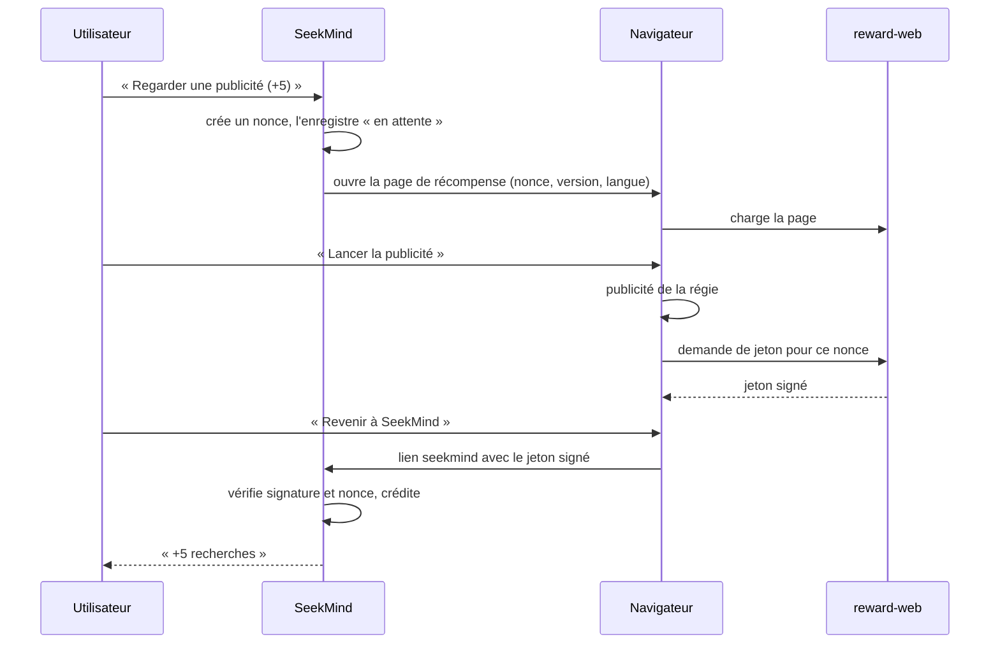

# Spec — Monétisation (`engine:monetization`, `feature:paywall`, `reward-web`, `tools/license`)

| | |
|---|---|
| **Exigences** | EF-MON-01 à 08, INV-01, INV-08 |
| **Tickets** | M8-01 à M8-08 |
| **Voir aussi** | [ADR-0002](../adr/0002-publicite-recompensee-hors-application.md) · [ADR-0007](../adr/0007-codes-d-activation-signes.md) |

## 1. Vue d'ensemble

| Formule | Recherches | Publicité |
|---|---|---|
| **Gratuite** | 1 crédit par recherche validée ; 10 crédits offerts ; +5 par publicité regardée | Dans le navigateur, à la demande de l'utilisateur |
| **Activée** | Illimitées, résultats au fil de la frappe | Aucune |

L'application n'a aucun accès réseau. Elle ne peut donc ni afficher une publicité, ni interroger un
serveur de licences. Les deux mécanismes reposent sur le même principe : **un jeton signé** par une clé
privée détenue par l'éditeur, **vérifié hors ligne** avec la clé publique embarquée dans l'application.

Capture, journal, suppression, réglages et actions contextuelles ne dépendent jamais de la formule (EF-MON-07).

## 2. Droits et crédits

```kotlin
sealed interface Entitlement {
    data class Free(val balance: Int) : Entitlement
    data class Activated(val licenseId: String, val plan: String) : Entitlement
}

interface EntitlementGate {
    val state: StateFlow<Entitlement>

    /** À appeler avant d'exécuter une recherche validée par l'utilisateur. */
    suspend fun authorize(queryKey: String): Authorization

    /** À appeler quand les résultats hybrides sont affichés. Débite si nécessaire. */
    suspend fun commit(queryKey: String, resultCount: Int)
}

sealed interface Authorization {
    data class Granted(val willCharge: Boolean) : Authorization
    data object NoCredit : Authorization
}
```

Règles :

| Cas | `authorize` | `commit` |
|---|---|---|
| Formule activée | `Granted(false)` | Rien |
| Même `queryKey` déjà débitée il y a moins de 10 min | `Granted(false)` | Rien |
| Solde ≥ 1 | `Granted(true)` | Débit de 1 **si** `resultCount > 0` |
| Solde nul | `NoCredit` → feuille de crédits | — |

- `queryKey` = texte normalisé de la requête + filtres ([recherche §9](recherche.md)).
- Une recherche sans résultat n'est jamais débitée (EF-MON-04). Une recherche assouplie qui trouve des
  résultats l'est.
- En formule gratuite, la recherche part sur validation explicite (touche « Rechercher ») ; en formule
  activée, elle part aussi au fil de la frappe, après 300 ms de pause.
- Le solde est la somme de `credit_ledger.delta`. Chaque mouvement est une ligne : `WELCOME` (+10, à la
  création de la base), `REWARD` (+n), `SEARCH` (−1).
- Plafonds : solde ≤ `maxBalance` (100) — une récompense est tronquée au plafond ; au plus
  `maxRewardsPerDay` (20) récompenses par jour civil.

L'état vit dans la base chiffrée. Une modification locale par un utilisateur ayant les droits root
reste possible : risque accepté, l'enjeu est commercial.

## 3. Jetons

### 3.1 Format

JWS compact, algorithme **ES256** (ECDSA P-256, SHA-256) :
`base64url(en-tête) . base64url(charge) . base64url(signature)`, la signature étant au format brut
`r ‖ s` de 64 octets.

En-tête : `{"alg":"ES256","kid":"<identifiant de clé>"}`.

| Type | Charge utile |
|---|---|
| Récompense | `{"typ":"reward","n":"<nonce>","amt":5,"iat":1794441600}` |
| Licence | `{"typ":"license","lid":"<identifiant>","plan":"lifetime","iat":1794441600}` et, facultatif, `"exp":<secondes>` |

### 3.2 Vérification (`TokenVerifier`, Kotlin pur + JCA)

Refus si l'une de ces conditions échoue, dans cet ordre :

1. Longueur ≤ 2 048 caractères ; trois segments en alphabet base64url.
2. En-tête : `alg` vaut exactement `ES256` (tout autre algorithme, y compris `none`, est refusé).
3. `kid` connu du trousseau embarqué, et l'usage de la clé (`reward` ou `license`) correspond au `typ`.
4. Signature valide : conversion `r ‖ s` → DER, puis `Signature.getInstance("SHA256withECDSA")`.
5. Charge : JSON valide, champs obligatoires présents et bien typés.

Trousseau : `keys-release.json` (clés de production) dans les sources principales ; `keys-debug.json`
(clés de test, parties privées committées) dans les sources `debug` uniquement.

```json
{ "keys": [
  { "kid": "r1", "purpose": "reward",  "spki": "<clé publique X.509 en base64>" },
  { "kid": "l1", "purpose": "license", "spki": "<clé publique X.509 en base64>" }
] }
```

Un test vérifie que le build `release` refuse un jeton signé par une clé de test.

## 4. Publicité récompensée

### 4.1 Déroulement



### 4.2 Côté application (`RewardFlow`)

**Démarrage**

1. Refus si le plafond quotidien est atteint (message explicite).
2. Nonce : 16 octets de `SecureRandom`, encodés en base64url (22 caractères). Ligne `reward_request`
   à l'état « en attente ». Au plus 5 demandes en attente : les plus anciennes passent à « expirée ».
3. URL : `rewardBaseUrl?n=<nonce>&v=<versionCode>&l=<fr|en>`. **Aucun autre paramètre, jamais** (T2 du
   modèle de menace) : la construction est centralisée dans une fonction testée.
4. Ouverture par un onglet personnalisé (`CustomTabsIntent`), qui ne requiert aucune permission.
   Aucun navigateur installé → message d'erreur.

**Retour** — `LinkActivity` reçoit `seekmind://reward?t=<jeton>` et appelle `RewardFlow.redeem` :

1. `TokenVerifier` (usage `reward`).
2. `amt` entre 1 et `maxRewardAmount`.
3. Le nonce existe, est « en attente », et a été créé il y a moins de `pendingTtlMs` (2 h).
4. Transaction : la demande passe à « utilisée » ; ligne `REWARD` dans le registre (tronquée au plafond).
5. Navigation vers la recherche avec le message « +n recherches ».

Tout échec affiche un message neutre (« Cette récompense n'est pas valable ») et ne modifie rien.
L'horloge du téléphone n'intervient que pour l'âge de la demande locale : `iat` n'est pas contrôlé,
car une horloge déréglée ne doit pas priver l'utilisateur de sa récompense.

### 4.3 Côté web (`reward-web`)

Application Cloudflare Workers : fichiers statiques + une fonction de signature.

```text
reward-web/
  src/worker.ts            routage, POST /api/reward/grant, GET /healthz
  src/jws.ts               signature ES256 (WebCrypto)
  src/ratelimit.ts
  public/reward.html       page de récompense (FR/EN)
  public/reward.js         logique de la page
  public/ads/gam.js        adaptateur Google Ad Manager
  public/ads/mock.js       adaptateur de test (environnement de recette uniquement)
  public/a.html            page de relais des liens d'activation (§5.3)
  wrangler.toml
  test/
```

**Page** `/reward`

1. Valide le format du nonce ; sinon message d'erreur.
2. Explique : « Regardez une publicité pour obtenir 5 recherches. SeekMind ne transmet à cette page
   aucune information sur vous ni sur votre téléphone. »
3. Recueille le consentement exigé par la régie et la réglementation.
4. Bouton « Lancer la publicité » → `adapter.show()` rend `granted`, `closed` ou `nofill`.
5. `granted` → `POST /api/reward/grant` → affiche un bouton « Revenir à SeekMind (+5) » :
   lien `intent://reward?t=<jeton>#Intent;scheme=seekmind;package=<identifiant d'application>;end`,
   avec repli `seekmind://reward?t=<jeton>`. Le retour exige un tap : les navigateurs bloquent les
   redirections automatiques vers une application.
6. `nofill` (aucune publicité disponible) → même parcours avec `outcome: "nofill"`, pour un crédit de
   courtoisie réduit : l'utilisateur n'est jamais bloqué par une absence de publicité.

**Adaptateur Google Ad Manager** (référence, bibliothèque GPT) :

```js
googletag.cmd.push(() => {
  const slot = googletag.defineOutOfPageSlot(AD_UNIT_PATH, googletag.enums.OutOfPageFormat.REWARDED);
  if (!slot) return resolve('nofill');                 // format non pris en charge sur cette page
  slot.addService(googletag.pubads());
  let granted = false;
  googletag.pubads().addEventListener('rewardedSlotReady', (e) => e.makeRewardedVisible());
  googletag.pubads().addEventListener('rewardedSlotGranted', () => { granted = true; });
  googletag.pubads().addEventListener('rewardedSlotClosed', () => {
    googletag.destroySlots([slot]);
    resolve(granted ? 'granted' : 'closed');
  });
  googletag.pubads().addEventListener('slotRenderEnded', (e) => {
    if (e.slot === slot && e.isEmpty) resolve('nofill');
  });
  googletag.enableServices();
  googletag.display(slot);
});
```

Changer de régie revient à écrire un autre adaptateur exposant `show()`.

**Fonction** `POST /api/reward/grant`

| Entrée | Contrôle |
|---|---|
| `n` | `^[A-Za-z0-9_-]{22}$` |
| `outcome` | `granted` ou `nofill` |
| `turnstile` | Jeton anti-robot vérifié auprès de Cloudflare (si configuré) |
| Origine | Même origine uniquement |
| Débit | Par adresse IP : 6 par heure et 30 par jour pour `granted` ; 3 par jour pour `nofill` |

Sortie : `{"token":"<JWS>"}` avec `amt = 5` (`granted`) ou `amt = 1` (`nofill`), signé par la clé
`REWARD_SIGNING_KEY` (secret du Worker). Aucune donnée n'est conservée au-delà des compteurs de débit,
qui expirent seuls.

Secrets et variables : `REWARD_SIGNING_KEY` (PKCS#8), `REWARD_KID`, `TURNSTILE_SECRET`, `AD_UNIT_PATH`,
`APP_PACKAGE`. Deux environnements : recette (adaptateur `mock`, clé `r-test`) et production.

### 4.4 Tests sans réseau

`FakeBrowserActivity` de l'application de test répond aux URL de récompense et renvoie un jeton signé
par la clé de test (scénario E2E-15). Les tests du Worker tournent sous Vitest avec l'environnement
Workers local. Les vecteurs de `testdata/tokens/` sont communs au vérificateur Kotlin et au Worker.

### 4.5 Limite assumée

La publicité récompensée sur le web ne fournit **pas** de confirmation de serveur à serveur : la page
déclare elle-même que la publicité a été vue. Un utilisateur technique peut donc appeler la fonction de
signature sans regarder de publicité. Parades : anti-robot, limitation de débit, plafond quotidien côté
application. Le risque résiduel est un manque à gagner sur une minorité d'utilisateurs (R-02).

## 5. Code d'activation

### 5.1 Émission (`tools/license`)

Outil en ligne de commande Python, exécuté par l'éditeur sur une machine de confiance.

| Commande | Effet |
|---|---|
| `seekmind_keys.py keygen --purpose license --kid l1` | Crée une paire ES256 ; écrit la clé privée (PEM) et la clé publique (`spki` en base64) |
| `seekmind_license.py issue --key l1.pem --kid l1 --plan lifetime --count 50 --out codes.csv` | Émet des licences : identifiant, code, lien d'activation |
| `seekmind_license.py verify --pub l1.spki <code>` | Vérifie un code |
| `gen_test_vectors.py` | Régénère `testdata/tokens/` avec les clés de test |

Un **code** est le JWS d'une licence (environ 230 caractères) : il se colle ou s'ouvre par un lien, il
ne se tape pas. Les codes courts à saisir exigent un serveur : ticket optionnel M8-07.

### 5.2 Activation dans l'application

Deux entrées, même traitement (`LicenseActivator.activate`) :

- **Coller** : Réglages → Code d'activation → champ de saisie et bouton « Coller ».
- **Lien** : `seekmind://activate?t=<code>` reçu par `LinkActivity`, qui affiche une confirmation
  (« Activer SeekMind sur ce téléphone ? ») avant d'agir.

Contrôles : `TokenVerifier` (usage `license`) ; `exp` absent ou futur ; `lid` absent de la liste de
révocation embarquée (`revoked_licenses.json`, mise à jour avec l'application). Succès → ligne unique
dans `license` → `Entitlement.Activated`. Échec → message précis : code illisible, signature invalide,
code expiré, code révoqué.

Réglages affiche l'identifiant de licence et propose « Retirer l'activation » (retour à la formule gratuite).

### 5.3 Lien cliquable

Un lien `seekmind://` n'est pas cliquable dans la plupart des messageries. Le lien remis à
l'utilisateur est donc `https://<domaine>/a#<code>` : la page statique `a.html` lit le fragment (jamais
transmis au serveur) et affiche un bouton « Activer SeekMind » pointant vers le lien d'application.

### 5.4 Limites assumées

- Un code n'est pas lié à un appareil : un code divulgué active plusieurs téléphones. Parade : liste de
  révocation, identifiant de licence traçable par l'éditeur.
- Une réinstallation exige de ressaisir le code (aucune sauvegarde).
- **Conformité** : distribution gratuite au lancement ; toute vente respecte la politique de paiement
  de Google Play dans le pays concerné (R-03, ADR-0007).

## 6. Interface (`feature:paywall`)

- **Indicateur** sur l'écran de recherche : « 7 recherches » (formule gratuite) ou badge « Activé ».
- **Feuille de crédits**, affichée sur `NoCredit` ou par tap sur l'indicateur :
  titre « Continuer à chercher » ; bouton principal « Regarder une publicité (+5 recherches) » ;
  bouton secondaire « J'ai un code d'activation » ; rappel « Vos données restent sur ce téléphone : la
  publicité s'ouvre dans votre navigateur. »
- Plafond quotidien atteint : le bouton de publicité est désactivé avec l'explication.

## 7. Configuration

```kotlin
data class MonetizationConfig(
    val welcomeCredits: Int = 10,
    val creditsPerReward: Int = 5,
    val maxRewardAmount: Int = 5,
    val maxBalance: Int = 100,
    val maxRewardsPerDay: Int = 20,
    val maxPendingRequests: Int = 5,
    val pendingTtlMs: Long = 2 * 3_600_000L,
    val freeRepeatWindowMs: Long = 600_000L,
    val liveSearchDebounceMs: Long = 300,
    val rewardBaseUrl: String,          // https://<domaine>/reward — fixé par le build
)
```

## 8. Tests attendus

- **JVM** : `TokenVerifier` sur `testdata/tokens/` (valide, signature altérée, charge altérée, `alg`
  inattendu, `kid` inconnu, usage croisé récompense/licence, jeton trop long, base64 invalide) ;
  conversion de signature ; registre de crédits (toutes les lignes du tableau du §2, plafonds, jour
  civil) ; `RewardFlow` (nonce inconnu, déjà utilisé, expiré, montant hors bornes) ; construction de
  l'URL (aucun paramètre hors `n`, `v`, `l`) ; activation (expiré, révoqué).
- **Instrumenté** : persistance du solde et de la licence ; `LinkActivity` avec entrées hostiles.
- **Bout en bout** : E2E-15.
- **Web** : Vitest sur le Worker (contrôles d'entrée, débit, signature vérifiée par les vecteurs communs).
- **Outils** : `pytest` sur `tools/license` ; un code émis par l'outil est accepté par le vérificateur Kotlin.
