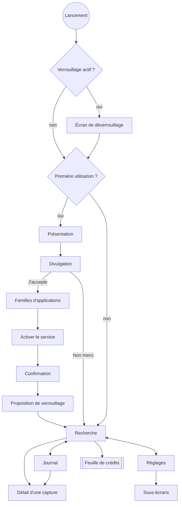

# Spec — Interface (`core:designsystem`, `feature:*`, `app`)

| | |
|---|---|
| **Exigences** | EF-ONB, EF-SRCH-05 à 09, EF-LANG, EF-JRN, EF-SET, EF-PRIV-10 à 12, ENF-A11Y-01, ENF-I18N-01, ENF-PERF-06 |
| **Tickets** | M6-01 à M6-09, M8-04 |

## 1. Principes

1. **La recherche est l'écran d'accueil.** Champ de saisie utilisable dès l'ouverture.
2. **La confiance se montre.** L'état de la mémorisation est toujours visible ; pause et suppression
   sont à un tap.
3. **Rien de trompeur.** Le libellé d'un bouton dit ce qu'il fera réellement (retour à la source).
4. **Sobriété.** Material 3, peu d'animations, aucune notification.

Technique : Jetpack Compose, Material 3, Navigation Compose à routes typées, un `ViewModel` par écran
exposant un `StateFlow<UiState>` immuable et recevant des événements (flux unidirectionnel). Aucune
logique métier dans les composables. Vouvoiement dans tous les textes.

## 2. Navigation

Barre inférieure à trois destinations : **Recherche**, **Journal**, **Réglages**. `LinkActivity` (liens
`seekmind://`) affiche son résultat puis ouvre l'écran de recherche.

## 3. Écrans

### 3.1 Accueil et consentement (`feature:onboarding`)

| Écran | Contenu | Actions |
|---|---|---|
| Présentation (3 pages) | « Retrouvez tout ce que vous avez vu » ; « Tout reste sur votre téléphone » ; « Vous gardez le contrôle » | Suivant, Passer |
| **Divulgation** | Texte de [05 §4](../05-conformite-play-store.md#4-écran-de-divulgation), défilant | « Non merci », « J'accepte » — ce dernier actif une fois le bas du texte atteint |
| Familles d'applications | « Que voulez-vous mémoriser ? » : navigateurs ; messageries et e-mails ; réseaux sociaux et vidéo ; autres applications. Quatre cases cochées par défaut, avec les icônes de quelques applications installées par famille. Rappel : banques, mots de passe et navigation privée ne sont jamais mémorisés. | Continuer (le choix est enregistré) |
| Activer le service | Trois étapes illustrées : ouvrir les réglages, choisir « SeekMind », activer | « Ouvrir les réglages » → `Settings.ACTION_ACCESSIBILITY_SETTINGS` |
| Confirmation | « La mémorisation est active » | Continuer |
| Verrouillage | « Protéger SeekMind par votre empreinte ou votre code » | Activer (par défaut), Plus tard |
| Pack de langue — seulement si aucune langue du téléphone n'est le français | « La recherche par mots-clés fonctionne dans toutes les langues. Pour chercher aussi par le sens dans votre langue, ajoutez le pack multilingue (118 Mo). » | Télécharger, Plus tard |

Au retour des réglages système (`onResume`), l'état du service est relu : actif → confirmation ; inactif
→ l'écran reste, avec un lien « Je n'y arrive pas » (aide par constructeur).

Le consentement est enregistré (`version`, `date`) à l'instant du tap sur « J'accepte », et le choix
des familles à la validation de son écran : tous deux avant la redirection vers les réglages système.

Le consentement **publicitaire** n'apparaît pas dans ce parcours : la fenêtre de Google s'affiche à la
première demande de publicité ([monetisation §3.3](monetisation.md)).

### 3.2 Recherche (`feature:search`)

De haut en bas :

1. **Bandeau d'état**, seulement si la mémorisation n'est pas active : « Mémorisation en pause —
   Reprendre », « Service désactivé — Réactiver », « Activer la mémorisation » (rouvre la divulgation).
2. **Champ de recherche**, avec à sa droite l'indicateur de crédits ou le badge « Activé ».
3. **Filtres** : pastilles « Période » (Aujourd'hui, Hier, 7 jours, 30 jours, Personnalisée) et
   « Application » (sélecteur des applications présentes dans l'index).
4. **Contenu**, selon l'état :

| État | Affichage |
|---|---|
| Vide (aucune requête) | Recherches récentes ; trois exemples de requêtes ; « Dernière mémorisation il y a 2 min » |
| Recherche en cours | Résultats par mots-clés dès qu'ils arrivent, indicateur discret « Affinage… » |
| Résultats | Liste de cartes ; en tête, les filtres compris dans la requête (« mardi soir », « Instagram ») sous forme de pastilles supprimables |
| Résultats assouplis | Bandeau « Rien trouvé mardi soir — voici d'autres dates » |
| Aucun résultat | Message, suggestions (retirer un filtre, reformuler), mention « Cette recherche ne vous a pas été décomptée » |
| Index sémantique incomplet | Mention « 120 écrans récents en cours d'analyse : la recherche par le sens s'améliore pendant la charge » |
| Sans crédit | Feuille de crédits ([monetisation §6](monetisation.md)) |
| Base indisponible | Écran d'erreur avec « Réinitialiser SeekMind » (ENF-REL-02) |

**Carte de résultat** : icône et nom de l'application ; date relative et heure (« mardi 21:12 ») ;
titre ou hôte de l'URL ; extrait de trois lignes au plus, termes surlignés ; mention « Texte lu dans
l'image » le cas échéant ; « + 3 similaires » si des doublons sont repliés ; bouton de retour à la
source au libellé exact ([retour-source §1](retour-source.md)). Un tap sur la carte ouvre le détail.

### 3.3 Détail d'une capture

Application, dates de première et dernière vue, nombre de vues, titre, URL ; texte complet sélectionnable
avec les termes de la recherche surlignés ; actions : retour à la source, copier, partager, supprimer
(avec confirmation) ; liens détectés.

### 3.4 Journal (`feature:journal`)

Liste regroupée par jour (en-têtes collants), une ligne par capture (application, heure, titre ou début
du texte). Filtre par application. Suppression par balayage avec annulation. Menu : « Supprimer cette
journée ». Chargement par pages de 50 (curseur sur la date). Jamais soumis aux crédits.

### 3.5 Réglages (`feature:settings`)

| Rubrique | Contenu |
|---|---|
| Mémorisation | État ; pause (1 h, jusqu'à demain, sans limite) ; reprise ; relire la divulgation ; retirer le consentement |
| Applications | Les quatre familles, avec interrupteur ; puis la liste des applications lançables avec interrupteur, famille et état par défaut expliqués ; recherche ; liste stricte verrouillée |
| Données | Durée de conservation ; budget de stockage ; espace utilisé, nombre de captures, plus ancienne ; supprimer par période, par application, tout effacer |
| Sécurité | Verrouillage de l'application ; délai de grâce |
| Langues de recherche | Modèle actif ; packs disponibles (taille, état, progression du téléchargement) ; utiliser, supprimer ; import d'un fichier de pack ; avancement de la reconstruction de l'index |
| Recherche | Historique : activer, effacer |
| Activation | Solde ou licence ; coller un code ; retirer l'activation ; « Confidentialité des publicités » lorsque la réglementation l'exige (variante `ads`) |
| Diagnostic | Compteurs du jour et des 7 derniers jours (captures, rejets par motif, OCR, vecteurs en attente) ; « Partager le diagnostic » (texte sans contenu) |
| À propos | Version ; politique de confidentialité (ouvre le navigateur) ; licences tierces |

« Tout effacer » demande de saisir le mot « EFFACER », puis ferme l'application sur l'écran d'accueil.

### 3.6 Verrouillage

`BiometricPrompt` avec `BIOMETRIC_WEAK or DEVICE_CREDENTIAL`. Tant que l'authentification n'a pas
réussi, **aucun contenu n'est composé** : seul un écran neutre avec le logo et « Déverrouiller »
existe. Délai de grâce de 5 min après le passage en arrière-plan. Si l'appareil n'a pas de
verrouillage sécurisé, le réglage est désactivé avec une explication.

Toutes les activités posent `FLAG_SECURE` (EF-PRIV-11).

### 3.7 Résultats de `LinkActivity`

| Lien | Succès | Échec |
|---|---|---|
| Activation | Confirmation « Activer SeekMind sur ce téléphone ? » → « SeekMind est activé » | Message précis ([monetisation §5.2](monetisation.md)) |

`LinkActivity` respecte le verrouillage : un lien reçu application verrouillée est traité après
déverrouillage.

## 4. Système de design

- **Couleurs** : couleur dynamique sur Android 12+, palette de marque en repli ; thèmes clair et sombre.
- **Typographie** : échelle Material 3 par défaut ; aucun texte sous 12 sp.
- **Formes et espacements** : grille de 4 dp ; cartes à coins de 16 dp.
- **Composants** (`core:designsystem`) : `StatusBanner`, `SearchField`, `FilterChipRow`, `ResultCard`,
  `HighlightedText`, `AppIcon`, `EmptyState`, `CreditBadge`, `ConfirmDialog`, `SettingRow`.
- **Icônes** : Material Symbols ; l'icône de l'application reste distincte et identifiable (jamais
  déguisée en outil système).
- **Aperçus** : chaque composant a des aperçus Compose en clair, sombre et police à 200 %.

## 5. Accessibilité et adaptation

- TalkBack : chaque élément interactif a un libellé ; une carte de résultat est lue comme une phrase
  (« Instagram, mardi 21 h 12, … ») ; les actions de la carte sont exposées en actions personnalisées.
- Cibles tactiles ≥ 48 dp ; contraste AA ; aucune information portée par la seule couleur.
- Police jusqu'à 200 % sans troncature bloquante.
- Bord à bord avec gestion des marges système ; geste de retour prédictif.
- Grands écrans : contenu limité à 640 dp de large, centré ; aucune orientation imposée.

## 6. Textes

- Toutes les chaînes en ressources, préfixées par module ; français et anglais (ENF-I18N-01).
- Pluriels par `plurals` ; dates par `java.time` et la locale du système.
- Ton : direct, concret, sans jargon technique (« mémorisation », pas « indexation »).
- Vocabulaire fixe :

| Concept | Français | Anglais |
|---|---|---|
| Capture | « écran mémorisé » | “remembered screen” |
| Service actif | « Mémorisation active » | “Memorisation on” |
| Formule activée | « Activé » | “Activated” |
| Crédit | « recherche » (« 7 recherches restantes ») | “search” |

## 7. Performance

- Démarrage : aucune ouverture du modèle d'embeddings avant la première frappe ; la base est ouverte
  hors thread principal ; profil de référence généré (ticket M10-04).
- Listes : `LazyColumn` avec clés stables ; icônes d'applications chargées hors thread principal et
  mises en cache en mémoire.

## 8. Tests attendus

- **ViewModels (JVM)** : chaque état du tableau du §3.2 ; annulation d'une recherche par la suivante ;
  enchaînement `authorize` → recherche → `commit`.
- **Compose UI** : divulgation (bouton inactif avant la fin du texte, retour arrière = refus) ; parcours
  de refus et réouverture ; carte de résultat (libellés du bouton par niveau de retour) ; verrouillage
  (aucun contenu composé avant authentification) ; réglages (pause, famille désactivée, exclusion
  d'une application, changement de modèle) ; écran des familles (quatre cases cochées, choix enregistré).
- **Accessibilité** : contrôles automatiques d'accessibilité activés dans les tests Compose ; passage
  manuel avec TalkBack (M6-08).
- **Captures d'écran de référence** : facultatif en v1.
